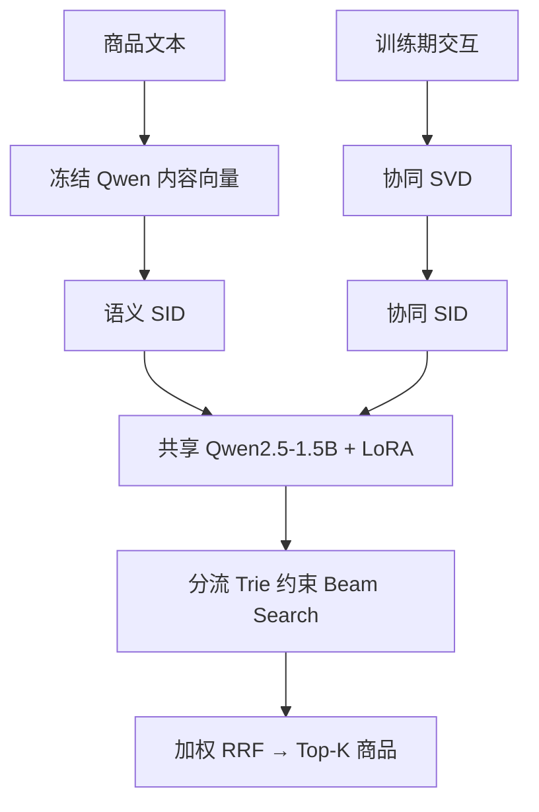

# DualSID-Qwen · 双流 SID 生成式推荐

基于 **Qwen/Qwen2.5-1.5B Base**，将商品内容与协同信号分别量化为两套 SID，通过共享的因果语言模型分别生成合法商品地址，再做双流候选融合。

这是可运行的研究项目：数据处理 → 双路量化 → LoRA 训练 → 约束检索 → 验证集调权 → 测试集评测。**已验证 CPU 小型 Qwen2 的完整闭环；尚未完成真实数据上的 1.5B 训练，也没有已验证的业务提升或榜单成绩。**

## 双流具体是什么

| 分支 | 输入表示 | 地址构建 | 生成历史 |
|---|---|---|---|
| 语义流 S | 商品文本的冻结 Qwen mean pooling embedding；轻量路径为 TF-IDF/SVD | 残差 K-Means → 分层语义码 → 碰撞后缀 | 历史商品的语义 SID |
| 协同流 C | **仅训练期** item-user 二值交互矩阵的 TruncatedSVD | 独立残差 K-Means → 分层协同码 → 碰撞后缀 | 历史商品的协同 SID |

两个流共用一套 Qwen 权重、LoRA 和 tokenizer，以 `<semantic>` / `<collaborative>` 区分任务；两路分别前向生成，采用加权 RRF 融合。它是 **双地址空间 + 共享参数 + 后融合** 的实现，不含双塔 cross-attention、可学习 gate 或两套完整 LLM。



## 先跑通：无需下载 1.5B

```bash
git clone https://github.com/WRF2004/dualsid-qwen.git
cd dualsid-qwen
python -m venv .venv
source .venv/bin/activate
# CPU；GPU 环境先安装适合驱动/CUDA 的 torch
pip install torch --index-url https://download.pytorch.org/whl/cpu
pip install -e '.[dev]'
OMP_NUM_THREADS=1 MKL_NUM_THREADS=1 python -m pytest -q
bash scripts/smoke.sh
```

Windows 建议 WSL。smoke 使用**随机初始化的两层小型 Qwen2**，相同的 LoRA、SID、训练、保存、加载和评估路径；它没有使用 Qwen2.5-1.5B 预训练权重。首次运行约需数十秒，依机器而异。重跑指定新目录：`bash scripts/smoke.sh runs/smoke2`。

## 真实数据与 1.5B 训练

建议在你的 H200 服务器上先用 **单卡 + 小规模真实子集** 验证，再扩大数据。当前发布支持单进程训练，不支持 torchrun/DDP。不能把 smoke 的耗时、指标或显存当作完整模型的表现。

### 1. 数据契约

`data/events.csv`：仅包含合法正反馈；ID 始终字符串，时间为同一单位的数值 Unix timestamp。

```csv
user_id,item_id,timestamp
u1,0001,1600000000
u1,0002,1600000300
```

`data/items.csv`：文本必须是训练截止前可用的元数据快照；不要加入未来销量、评论或标签。

```csv
item_id,text
0001,"运动鞋 跑步 轻便"
0002,"篮球鞋 室内运动"
```

```bash
# 数值仅为示例；根据实际数据日期预先确定 cutoffs
python -m dualsid.cli prepare --events data/events.csv --items data/items.csv \
  --train-end 1600000000 --val-end 1600600000 --max-history 30 --output data/prepared
```

训练时间 `t <= train_end`；验证 `train_end < t <= val_end`；测试 `t > val_end`。训练样本只能看到更早时间的行为；同时间行为不互相可见。验证/测试每用户选窗口最后时间戳的商品集合为 relevance set；验证历史截至 train_end，测试历史截至 val_end，不包含测试窗口交互。

商品目录冻结在训练期，测试新商品保留在 Recall/NDCG 分母，并报告 OOV 比例。未知历史商品会被跳过。默认允许复购；只有任务禁止重复推荐时才统一使用 `--exclude-seen`，此时不要删掉无法命中的重复目标。

MovieLens 1M 转换器：从 [GroupLens](https://grouplens.org/datasets/movielens/1m/) 按其许可获得 `ml-1m/`，运行：

```bash
python scripts/convert_movielens.py --raw data/ml-1m --output data/ml1m
# 仅 rating >= 4 转正反馈；之后仍需 prepare 固定全局时间切分
```

### 2. 编码商品文本，构建两套 SID

```bash
CUDA_VISIBLE_DEVICES=0 python -m dualsid.cli encode \
  --data data/prepared/dataset.json --output data/text.npz \
  --model Qwen/Qwen2.5-1.5B --device cuda --batch-size 8 --max-length 128
python -m dualsid.cli sid --data data/prepared/dataset.json \
  --embeddings data/text.npz --output data/prepared/sid.json \
  --levels 3 --size 64 --dim 64 --seed 42
```

编码采用冻结的 Base 模型 mask mean pooling + L2 归一化，是可替换的初始方案，**不是专门训练过的 embedding 模型**。也可使用其他编码器生成 NPZ：字符串 `item_ids[N]`、浮点 `embeddings[N,D]`。工具按 raw ID 对齐、检查缺失和非有限值；禁止 object/pickle 数组。

省略 `--embeddings` 时会使用字符 TF-IDF/SVD，适合小规模调试与内容表示消融。量化方法为残差 K-Means，**不是 RQ-VAE**。`sid.json` 保存两路码本、映射、原始碰撞率、最大桶、每层困惑度与使用码数量。

### 3. LoRA 训练、恢复

```bash
CUDA_VISIBLE_DEVICES=0 python -m dualsid.cli train \
  --data data/prepared/dataset.json --sid data/prepared/sid.json \
  --config configs/qwen.json --output runs/qwen-dual
```

配置默认 bf16、SDPA、梯度检查点、梯度累积、梯度裁剪。每个训练样本展开成两个任务，仅目标 SID 与 EOS 参与交叉熵；历史与 padding 的 labels 为 -100。按验证 **token loss** 选择最佳 epoch；不声称按 NDCG 选模。

新增 SID token 不能只训练 LoRA：本实现显式解除输入/输出权重绑定，将 `embed_tokens` 与 `lm_head` 纳入训练和保存。**这两个完整大矩阵明显增加显存、优化器状态和 adapter 磁盘占用**；这里不宣称是“只有几 MB”的纯 LoRA。1.5B 显存尚未实测，OOM 先减 batch_size/max_length。

中断后用原配置和精确 checkpoint 路径恢复，包含优化器、scheduler、RNG；数据、SID、配置哈希不一致会拒绝恢复：

```bash
python -m dualsid.cli train --data data/prepared/dataset.json \
  --sid data/prepared/sid.json --config configs/qwen.json --output runs/qwen-dual \
  --resume runs/qwen-dual/checkpoint-1000
```

以实际存在的 `checkpoint-*` 替换示例。当前不允许修改 epochs 后续训；延长实验请新建 run，并明确记录训练预算。

### 4. 验证调权，独立测试

```bash
python -m dualsid.cli tune --data data/prepared/dataset.json --run runs/qwen-dual \
  --device cuda --k 10 --beam 40 --output runs/qwen-dual/fusion.json
# 从 fusion.json 读取 best_alpha；以下 0.5 仅为示例，替换为验证选出的值
python -m dualsid.cli evaluate --data data/prepared/dataset.json --run runs/qwen-dual \
  --device cuda --k 10 --beam 40 --alpha 0.5 --output runs/qwen-dual/test.json
python -m dualsid.cli baseline --data data/prepared/dataset.json \
  --k 10 --output runs/popularity.json
python -m dualsid.cli recommend --run runs/qwen-dual --device cuda \
  --history 0001,0002 --k 10 --beam 40 --alpha 0.5 --output runs/recommendation.json
```

输出 Hit/Recall/NDCG@K、目录覆盖率、OOV 目标比例、预热后逐请求 p50/p95 延迟与逐用户预测。对**完整冻结目录**建 Trie，不采样负例；beam 是近似搜索，不是精确全目录排序。每流最多生成 beam 个候选，RRF 对两路并集排序；不会强制生成不存在的商品 ID。

`alpha` 是语义流权重：`alpha/(60+rank_S) + (1-alpha)/(60+rank_C)`；某流未召回时该项为 0。只在验证集挑选，测试集仅做最终报告。

## 消融与实验

1. 在同一双流 checkpoint 上评估 `--mode semantic` / `--mode collaborative` / `--mode dual`，检查后融合贡献。
2. 复制 `configs/qwen.json`，将 mode 改为 semantic 或 collaborative，**分别重新训练**。控制总优化步数或总 token 预算；默认 dual 样本数加倍，不能直接把“同 epoch”当作等预算。
3. 用相同切分比较 TF-IDF 与冻结 Qwen embedding；比较 levels/size/beam/历史长度，记录碰撞率和覆盖率。
4. 每组至少 3 个种子，只看验证集定方案；报告实际训练时间、GPU 峰值显存、参数量和测试均值/方差。不要凭合成数据写“提升 X%”。

补充对照可参考独立项目 [GenRec Arena](https://github.com/WRF2004/genrec-arena) 中的小型 Transformer 与 RQ-VAE 实验。两套数据协议不同，**先统一候选目录、时间边界和目标定义再比较数值**。

## 文件与实现边界

| 文件 | 作用 |
|---|---|
| `dualsid/data.py` | CSV、严格时间窗口、演示数据 |
| `dualsid/encode.py` | 冻结 Qwen 文本向量 |
| `dualsid/sid.py` | 内容/协同残差量化、消歧、Trie |
| `dualsid/model.py` | 新 token、LoRA、loss mask、prompt |
| `dualsid/train.py` | Trainer、断点恢复、数据校验、加载 |
| `dualsid/retrieval.py` | Beam、RRF、指标、延迟 |
| `tests/` | 单元测试与真实训练/保存/重载/恢复测试 |
| `reports/` | 真实执行的 CPU 合成数据验收结果 |

当前是单机研究实现：样本与矩阵在内存，训练样本构建在长序列时会较慢；beam 每步重新计算上下文，未做 KV cache、跨用户批处理、在线 API 或大规模吞吐验证。新商品加入需重建 SID 并重训，不能宣称解决冷启动。没有对齐损失或可学习融合参数；两种特征和后融合构成可验证的基线。

`runs/*/best/` 保存最佳 adapter（或完整非 LoRA 模型），`tokenizer/`、`sid.json`、`config.json`、`manifest.json` 必须一起保留。加载还需要同版本原始 Qwen Base 权重；`best/` 单独不是完整模型。下载时固定模型 revision/本地快照可加强复现。只从可信来源恢复含优化器状态的 Trainer checkpoint。

## 参考与许可

- [Qwen2.5-1.5B 模型卡](https://huggingface.co/Qwen/Qwen2.5-1.5B)：Base 骨干与上游模型许可。
- [Qwen2 Transformers 文档](https://huggingface.co/docs/transformers/model_doc/qwen2)：模型 API。
- [PEFT LoRA](https://huggingface.co/docs/peft/developer_guides/lora)：适配器与保存模块。
- [TIGER: Recommender Systems with Generative Retrieval](https://arxiv.org/abs/2305.05065)：分层语义 ID、自回归推荐的研究来源。
- [MovieLens 1M](https://grouplens.org/datasets/movielens/1m/)：可选真实数据，遵守原始使用条款。

实现代码采用 MIT 许可；模型和数据保留各自许可。本实现不是上述论文的官方数值复现，也不把后融合基线包装成已验证的新算法。
